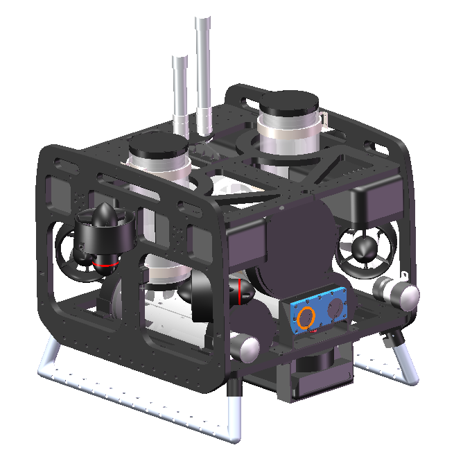
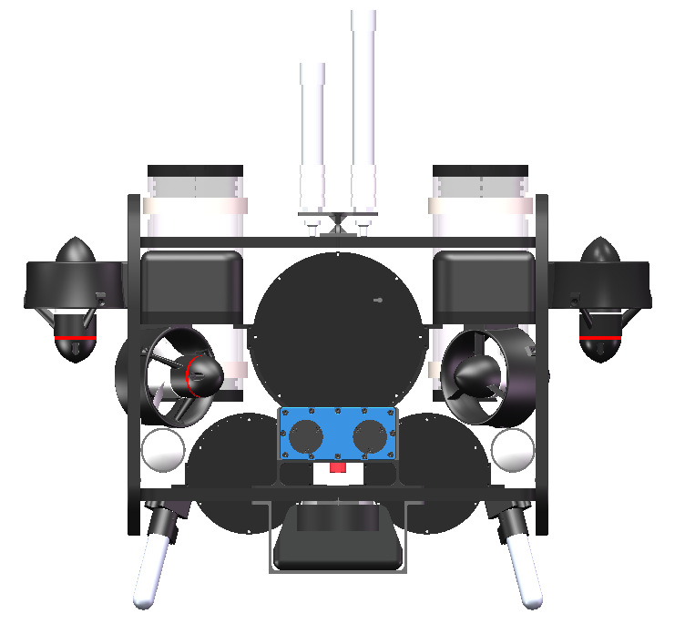
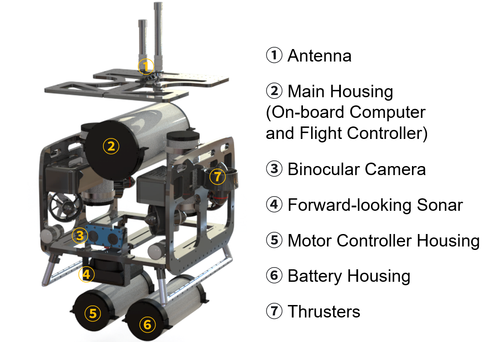

# VURAM ROS1 Packages

## 1. Project Overview

This catkin workspace provides ROS1 drivers, robot models, motion control, trajectory planning, and algorithm validation tools for VURAM. It supports sensor integration, simulation, and experiments through MAVROS/ArduSub, with RViz visualization and data analysis utilities.

| VURAM Axonometric View | VURAM Front View |
| :---: | :---: |
|  |  |

| VURAM Exploded View |
| :---: |
|  |

## 2. About VURAM

VURAM is an underwater robot platform for research in underwater perception, localization, motion control, and target tracking. Its onboard sensors include a forward-looking sonar and a Water Linked DVL A50.

For details on the robot's design, see the [VURAM design website](https://gudfish.github.io/).

## 3. Package Overview

The `src/` directory currently contains the following ROS packages, grouped by their primary purpose:

| Category | Package | Purpose |
| --- | --- | --- |
| $\color{blue}\text{Sensor Drivers}$ | [sonar_driver](src/sonar_driver/) | Publishes images from a physical forward-looking sonar using the vendor SDK. |
| $\color{blue}\text{Sensor Drivers}$ | [dvl_odometry](src/dvl_odometry/) | Provides Water Linked DVL A50 data, odometry, calibration/reset services, and a device simulator. |
| $\color{teal}\text{Robot Description}$ | [vuram_description](src/vuram_description/) | Provides URDF files, meshes, and illustrations for robot visualization. |
| $\color{purple}\text{Basic Control}$ | [vuram_control](src/vuram_control/) | Provides MAVROS/ArduSub motion and thruster control, trained policy deployment, and visualization. |
| $\color{orange}\text{Trajectory Planning}$ | [vuram_planning](src/vuram_planning/) | Generates smooth trajectories to RViz goals at the current depth for policy tracking. |
| $\color{red}\text{Algorithm Validation}$ | [fls_detector](src/fls_detector/) | Provides sonar simulation, image-based target detection, and sensing-range visualization. |
| $\color{red}\text{Algorithm Validation}$ | [sub_planning](src/sub_planning/) | Provides target estimation, MPC/LOS tracking, sensor simulation, and experiment evaluation. |

For DVL connection parameters and interfaces, see the [dvl_odometry guide](src/dvl_odometry/README.md).

## 4. Test Environment

The project's existing development and build records correspond to the following environment:

| Component | Version / Tool |
| --- | --- |
| Operating System | Ubuntu 20.04.6 LTS (Focal Fossa) |
| ROS | ROS1 Noetic |
| Build System | catkin (`catkin_make`) |
| Python | Python 3 |

The vendor SDK included with `sonar_driver` targets Linux ARM64 (`aarch64`). The current build configuration compiles this package only on `aarch64` / `arm64` platforms and skips it on other architectures. These environment records do not imply that every package has completed testing on the physical robot. Compatibility with other Ubuntu and ROS versions has not been confirmed.

## 5. Simulation Without a Physical Robot

If a physical robot is unavailable, you can use the simulation approaches described in the [official ArduPilot simulation documentation](https://ardupilot.org/dev/docs/simulation-2.html):

- **SITL (Software In The Loop):** runs ArduPilot firmware and a vehicle dynamics model on a computer without a physical flight controller. Use ArduSub SITL to test the ROS control and planning interfaces through MAVROS.
- **Gazebo with SITL:** combines ArduPilot SITL with a simulated environment for physics and visualization. Underwater simulation requires a suitable vehicle model and simulation plugins configured for ArduSub.

Set up and start the simulator separately, then connect this workspace through MAVROS. This repository does not include a complete Gazebo simulation environment or launch the external simulator automatically.
