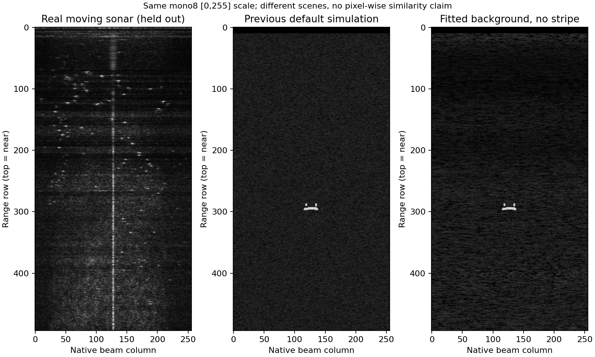
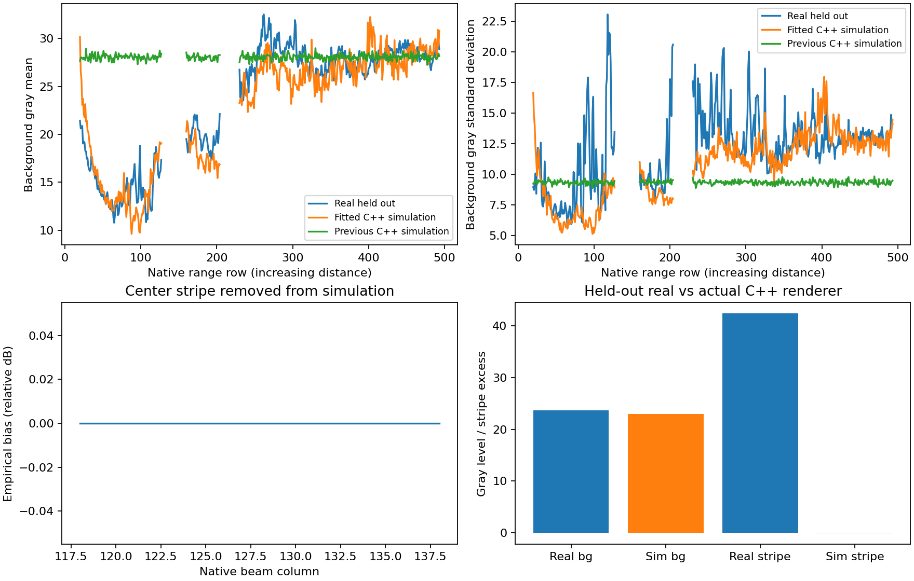
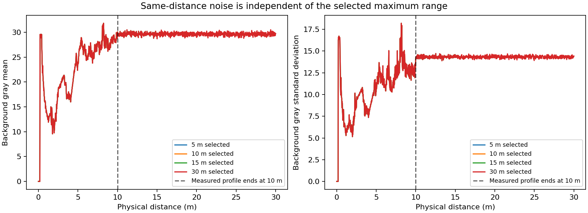
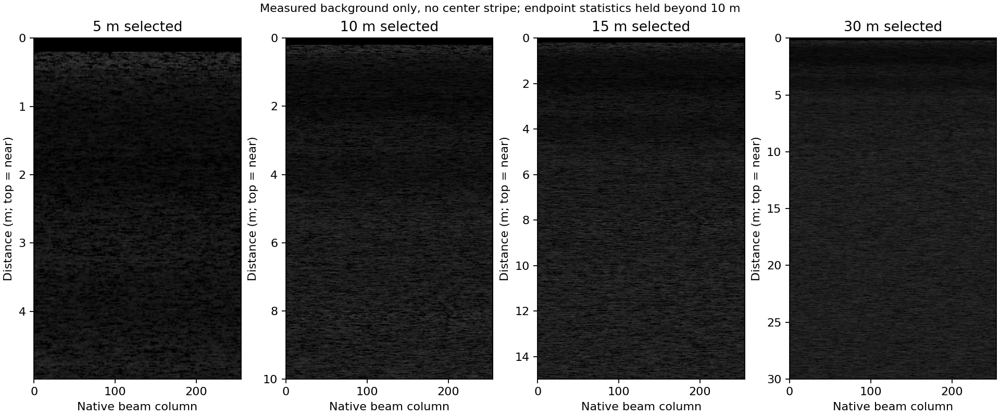
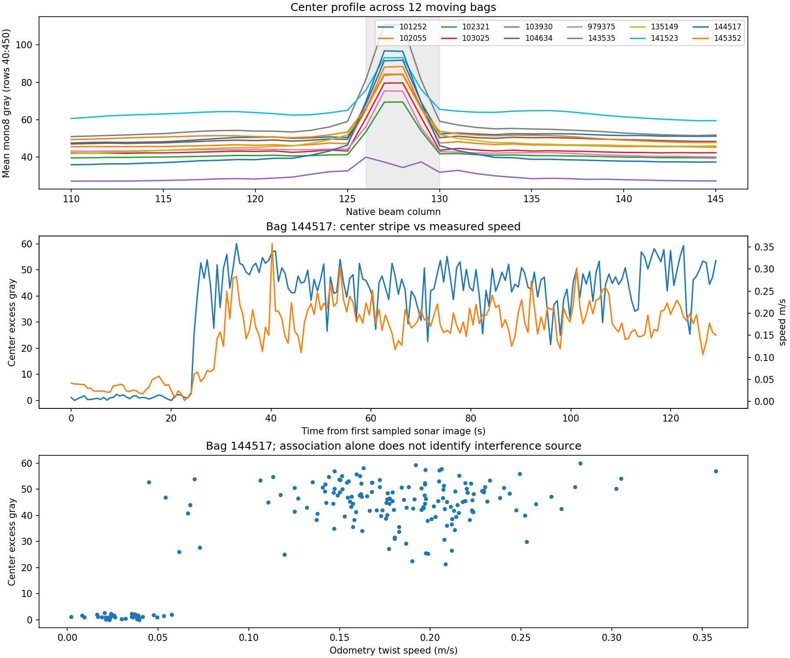

# 实测背景与中心亮条统计

2026-11-09，BHQ-750D。结果是**相对显示域经验拟合**，不是绝对接收功率或完整设备标定。所有原生距离—方位图均保持**上近、下远、顶部中心原点**，没有上下翻转；没有把伪彩、UI、扇形重采样图当作原始统计输入。

## 已接入的配置

- `config/bhq750d_noise_experiment_10m.yaml`：494 个距离行的背景均值／标准差，`noise_profile_range_m: 10.0` 明确距离轴，`noise_beam_bias_db: []` 移除中心亮条。所有量程均默认加载；10 m 原始图为 494×256，其他量程可使用自动距离栅格，扇形输出仍为 512×256。
- `config/bhq750d_noise_stationary_reference.yaml`：静止 `frame3` 近水背景参考，常量均值／标准差、无中心条。静止图片没有可靠量程元数据，不能将 625 行强行映射到运动 bag 的 494 行，因此没有拟造静止全量程剖面。
- `forward_sonar_sim.launch` 在 10 m 时加载历史采样栅格，其他量程使用自动栅格；噪声在所有量程默认启用。噪声剖面按**实际距离**查表，量程为 5/10/15/30 m 时，同一距离使用同一统计参数。超过实测 10 m 后保持端点均值／标准差，属于明确的外推，不是远距离标定。

```bash
roslaunch fls_detector bhq750d_compare.launch

# 显式选择静止背景参考。
roslaunch fls_detector bhq750d_compare.launch \
  noise_profile:=$(rospack find fls_detector)/config/bhq750d_noise_stationary_reference.yaml
```

需要重启节点加载修改后的配置。中心亮条仅保留在实测数据的原因分析中，不再加入仿真；原始 bag/JPEG 没有修改。

## 数据与方法

1. 检查 `bagfiles/experiment` 的 13 个 bag，12 个含原始 `/forward_sonar/image_raw`，共 28,061 帧。抽检原图均为 `494×256 mono8`，未录制 SDK 采集元数据。`b1_143009` 无图；上午 `103930` 中途明显变暗，排除在拟合数据之外。
2. 静止目录共有 1000 张源灰度 JPEG，去重后 997 张；连续编号序列共 995 张。`frame_test` 与 `frame3` 重复，`frame1/255` 与 `36` 重复；异常编号不当作连续时间。`frame1` 原生 468 行，`frame2/3` 625 行，分别统计。JPEG 压缩和未知设备显示设置也会影响统计。
3. 运动拟合使用下午 `144517` bag：相对首个声呐消息 **56.35–62.35 s** 均匀选 60 帧，使用人工查看的低回波背景列 **200:232**。排除近场行 `0:20` 和明显混响带 `128:160`、`205:230`，这些行的剖面通过有效行插值，端点使用最近值。排除行不参与测量统计。
4. 独立时间窗口 **98.23–104.23 s** 的 60 帧作留出验证。侧方背景仍可能含少量零散回波，不能视作全视场纯电子噪声。统计也包含未分辨的扩散杂波。
5. 假设 `gamma=150/255`、显示 dB 区间 `[0,75]`，以 `75*(gray/255)^(255/150)` 近似逆映射。每个距离行对所选像素做 5/95% Winsorize，再计算均值、标准差及邻波束相关；裁剪后的标准差是保守统计量。保存 `noise_floor_power=1`、`noise_rayleigh_db=0`，避免额外重复增加瑞利噪声；固定 `gain_db=0`、`gain_assist=false`。
6. 背景拟合列 `200:232` 避开了中心条；当前配置和生成脚本均不输出中心条模板。距离剖面采样点覆盖 0–10 m，查表坐标为 `clamp(r/10, 0, 1)*(N-1)`。因此最大量程变化不会拉伸剖面；测量范围外沿用端点统计。
7. 静止参考使用 `frame3` 原生 ROI `[x0,y0,x1,y1)=[100,35,190,110)`，编号 `0:600:5` 的 120 帧拟合，`600:894:5` 的 59 帧验证。因未知米制距离映射，仅提供近水背景的常量参考：均值 **1.619**、标准差 **0.860** 相对 dB，不混入运动数据拟合。

原始帧索引、实际时间、排除区域、来源和假设保存于配置的 `noise_profile_source` 及 [statistics.json](statistics.json)。

## 留出验证

使用实际 C++ `Renderer::display` 生成 64 帧纯背景，固定原生 `494×256` 栅格和随机种子；表中灰度统计使用同样的背景 ROI／有效距离行。亮条超额使用中心 `126:131` 相对邻列、距离行 `40:450` 的平均差。

| 统计量 | 留出真实帧 | 新 C++ 仿真 | 原默认 C++ 仿真 |
|---|---:|---:|---:|
| 背景灰度均值 | 23.66 | 22.93 | 28.07 |
| 背景灰度标准差 | 13.91 | 12.52 | 9.35 |
| 邻波束空间相关 | 0.761 | 0.726 | 0.361 |
| 中心条平均超额灰度（仿真已移除） | 42.34 | -0.04 | -0.02 |
| 背景零灰度比例 | 0.38% | 7.79% | 0.62% |

主要剩余误差是正偏长尾、黑像素比例和空间／时间纹理。当前高斯显示域模型不能完整重现正值、长尾的实测分布；它的零灰度比例偏高。背景均值也会叠加到目标显示亮度，不能当作真实线性接收噪声模型。池底与墙面混响仍需实际几何。这里不宣称完成实机相似度验收。



以上是不同场景、相同灰度显示范围的定性比较，没有计算逐像素 PSNR/SSIM。



## 不同量程的一致性

2026-11-10 更新：实测背景在各量程默认启用，中心亮条移除。用同一份 0–10 m 噪声数据，在统一原生网格、随机种子和帧编号下分别生成 5/10/15/30 m 纯背景；重叠的有效物理距离区域逐像素比较，最大灰度差均为 0。该验证包括小于测量范围的裁剪、测量范围内插值和超过 10 m 的端点外推。采样和结果见 `statistics.json` 的 `range_consistency`。





## 中心亮条的原因

对 12 个含图 bag 分别跨全时段抽 200 帧，比较中心列与邻列并对齐里程计／飞控状态。[统计记录](centerline_diagnosis.json)中保存了各 bag 的分组结果及 2400 帧时间、速度、解锁状态和亮条超额。

以 `144517` 为例：相对首个原始图，**24.049 s** 从 MANUAL 切入 GUIDED，抽样在 **24.602 s** 首次出现明显中心条；前 20 s 平均超额约 **1.06** 灰度，30–60 s 为 **47.46**。全段亮条与速度相关 `r=0.769`，但仅在速度大于 0.08 m/s 的运动段，相关降为 **0.023**。因此全段相关主要来自进入工作状态前后的差异，不能推断为速度越大亮条越强。该段始终 armed，单用解锁状态也解释不了。

强中心峰在 11/12 个 bag 固定于 127/128 列。`144517` 航向变化约 134.65°，亮条仍固定于传感器中心；静止近水背景的中心／邻列灰度比，`frame1/2/3` 分别约 **1.110／1.016／0.996**，没有这种强条。原始 bag 中已有亮条，排除了 RViz／扇形转换／检测框作为来源；当前驱动可见代码没有对中心列特殊补线，但闭源 SDK 和历史采集版本不能完全排除。

这些证据优先支持**设备工作状态相关的干扰候选**。应先检查 ESC、DC/DC、供电共模与接地屏蔽耦合，同时保留推进器声学／机械耦合等候选；现有数据没有 PWM、ESC 转速、电流或独立供电对照，无法确定具体原因。`103930` 全段 disarmed 仍有较弱中心邻峰，也说明不能把所有中心峰一概归因于推进器。

[MarineSitu / OERA 实测报告，第 16 页](https://oera.ca/sites/default/files/2019-06/James%20Joslin%20Report%20-%20Imaging%20sonar%20review%20for%20marine%20mammal%20and%20fish%20monitoring%20around.pdf)记录了电源转换器及设备触发造成细径向亮线的实例。这只是排查依据，不是对 BHQ-750D 的因果确认。



下一次采集应固定量程、频率、增益、gamma 和自动增益设置，对照静止停桨、固定机器人后开桨、停桨外力拖动、声呐独立供电，同时录制 PWM／电流。这样才能区分动力系统干扰与运动本身。

## 重现

在工作区根目录执行，校准脚本会重建两份配置、抽样来源及报告；原始 bag/JPEG 只读：

```bash
/usr/bin/python3 src/fls_detector/scripts/calibrate_bhq_experiment.py

g++ -std=c++14 -O2 -I src/fls_detector/include \
  src/fls_detector/docs/noise_calibration/render_profile.cpp \
  -L devel/lib -lsonar_renderer -fopenmp \
  -Wl,-rpath,"$PWD/devel/lib" -o /tmp/render_noise_profile

/tmp/render_noise_profile src/fls_detector/docs/noise_calibration/motion_renderer_input.txt \
  /tmp/motion src/vuram_description/meshes/AUV.STL
/tmp/render_noise_profile src/fls_detector/docs/noise_calibration/stationary_renderer_input.txt \
  /tmp/stationary src/vuram_description/meshes/AUV.STL
/tmp/render_noise_profile src/fls_detector/docs/noise_calibration/default_renderer_input.txt \
  /tmp/default src/vuram_description/meshes/AUV.STL

# 可选量程参数，用于生成跨量程验证数据。
for distance in 5 10 15 30; do
  /tmp/render_noise_profile src/fls_detector/docs/noise_calibration/motion_renderer_input.txt \
    /tmp/range${distance} src/vuram_description/meshes/AUV.STL "$distance"
done

MPLCONFIGDIR=/tmp/bhq_plot_cache /usr/bin/python3 \
  src/fls_detector/docs/noise_calibration/plot_results.py --render-dir /tmp
```

通用 `calibrate_sonar_noise.py` 另支持多 bag、多段波束 ROI、时间窗口、均匀取样、距离行排除和 JSON 报告；它不自动识别背景。
